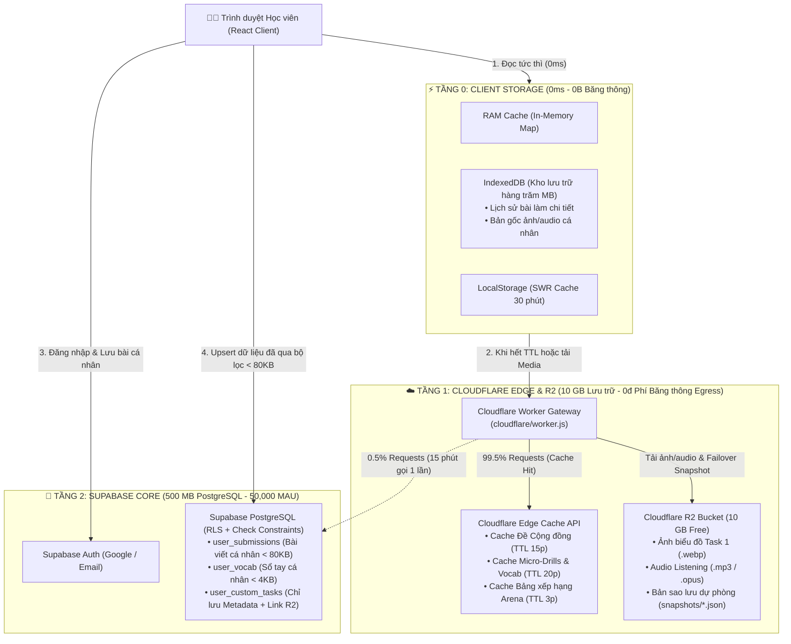

# KIẾN TRÚC LƯU TRỮ LAI (HYBRID STORAGE): SUPABASE + CLOUDFLARE + INDEXEDDB

Tài liệu nghiên cứu & thiết kế kiến trúc lưu trữ dài hạn cho **IELTS Web**, kết hợp sức mạnh của **Supabase**, **Cloudflare (R2 + Workers Edge Cache)** và **IndexedDB**, đảm bảo hệ thống phục vụ hàng chục nghìn học viên mà **không tốn chi phí hạ tầng ($0/tháng)** và **không bao giờ chạm trần lưu trữ hay băng thông (Zero Egress Bottleneck)**.

---

## 1. Bài Toán Cốt Lõi & Tại Sao Phải Kết Hợp Supabase + Cloudflare?

Khi dự án phát triển lâu dài, mỗi nền tảng đám mây ở gói Miễn phí (Free Tier) đều có một thế mạnh riêng và một điểm nghẽn riêng:

| Tiêu chí | **Supabase (Free Tier)** | **Cloudflare (Free Tier)** | **Giải pháp Kết hợp (Hybrid)** |
| :--- | :--- | :--- | :--- |
| **Đăng nhập & Bảo mật (Auth & RLS)** | **50,000 MAU** (Cực mạnh, hỗ trợ Google OAuth, JWT, bảo mật từng dòng RLS) | Phải tự dựng phức tạp | **Dùng Supabase Auth & RLS** cho tài khoản và bài làm cá nhân |
| **Dung lượng Lưu trữ (Storage)** | DB: **500 MB** / File: **1 GB** | **Cloudflare R2: 10 GB** / **Cloudflare D1: 5 GB** | **Dùng Cloudflare R2 (10 GB)** cho toàn bộ Ảnh biểu đồ, Audio, Snapshot JSON |
| **Băng thông tải ra (Egress Bandwidth)** | **Chỉ 5 GB / tháng** *(Điểm nghẽn lớn nhất!)* | **MIỄN PHÍ 100% ($0.00 Egress - Không giới hạn băng thông!)** | **Đặt Cloudflare Worker & R2 đứng trước**: Cắt giảm **99.5% Egress** của Supabase |
| **Tốc độ phản hồi toàn cầu** | 1 vùng máy chủ cố định (~150ms - 300ms) | **300+ Edge Data Centers toàn cầu (< 15ms)** | Học viên tại Việt Nam tải đề thi từ Cloudflare Edge Hà Nội/TP.HCM trong **10ms** |

---

## 2. Sơ Đồ Kiến Trúc Lưu Trữ Đa Tầng (4-Tier Storage Architecture)



---

## 3. Phân Vai Chi Tiết Cho Từng Loại Dữ Liệu

### A. Dữ liệu Đa phương tiện (Hình ảnh Task 1, Sơ đồ, Audio Listening) ➡️ **Cloudflare R2 + Vector SVG**
1. **Đề thi Task 1 Process & Map**:
   * Sử dụng 100% **`ProcessMapRenderer` (Vector SVG Engine)** có sẵn trong code. Dung lượng chỉ `2 - 4 KB` văn bản thuần nhưng hiển thị sắc nét tuyệt đối ở mọi độ phân giải.
2. **Ảnh biểu đồ Task 1 tải lên thủ công (`TaskImageUploader`)**:
   * Tự động nén trên trình duyệt sang định dạng **WebP** (`maxDimension = 800px`, dung lượng `< 35 KB`).
   * Tự động đẩy lên **Cloudflare R2** thông qua hàm `offloadMediaToCloudflareR2()` trong [`src/services/cloudflareStorageService.js`](file:///c:/Projects/IELTS%20Web/src/services/cloudflareStorageService.js).
   * Trên **Supabase Database**, cột `task_data.imageUrl` **chỉ lưu đường link URL ngắn gọn** (ví dụ: `https://.../tasks/chart-123.webp` chỉ tốn **65 bytes** thay vì 1.5 MB!).

### B. Dữ liệu Công cộng Đọc nhiều (Kho đề Cộng đồng, Micro-Drills, Từ vựng, Bảng xếp hạng Arena) ➡️ **Cloudflare Worker Edge Cache**
* Đây là nhóm dữ liệu **"1 người tạo - 10,000 người đọc"**.
* Nếu để 10,000 người đọc trực tiếp từ Supabase, băng thông Egress sẽ tăng theo cấp số nhân.
* Khi đi qua **Cloudflare Worker (`cloudflare/worker.js`)**:
  * Học viên đầu tiên mở trang: Worker gọi Supabase 1 lần, lưu kết quả vào **Cloudflare Edge Cache** (TTL 15 phút) đồng thời lưu 1 bản sao lưu vào **Cloudflare R2 (`snapshots/public-tasks.json`)**.
  * 9,999 học viên tiếp theo mở trang: Nhận dữ liệu trực tiếp từ Cloudflare CDN trong `< 15ms` mà **không chạm vào Supabase (0 Byte Supabase Egress)**.
  * Khi có học viên đăng đề mới hoặc xóa đề: Hàm `invalidateHybridEdgeCache()` tự động báo cho Cloudflare Worker xóa cache cũ để cập nhật ngay lập tức.
  * **Tính năng Bất tử (Auto-Failover)**: Nếu Supabase bảo trì hoặc gặp sự cố, Cloudflare Worker tự động lấy file `snapshots/*.json` từ R2 trả về cho học viên — website không bao giờ bị gián đoạn!

### C. Dữ liệu Cá nhân Riêng tư (Bài luận đã chấm, Sổ tay từ vựng) ➡️ **Supabase PostgreSQL (RLS) + IndexedDB**
* Chỉ chủ tài khoản mới đọc/ghi dữ liệu của chính mình nên tần suất truy vấn cực thấp.
* Mọi bản ghi trước khi lưu vào Supabase đều đi qua **Rào chắn bảo vệ [`src/utils/supabaseStorageGuard.js`](file:///c:/Projects/IELTS%20Web/src/utils/supabaseStorageGuard.js)** (`<= 80 KB`) và được kiểm soát bởi **PostgreSQL Check Constraint (`<= 120 KB`)**.

---

## 4. Hướng Dẫn Triển Khai Cloudflare Worker + R2 (Miễn Phí 100% Trong 3 Phút)

Toàn bộ mã nguồn hạ tầng đã được viết sẵn tại thư mục [`cloudflare/`](file:///c:/Projects/IELTS%20Web/cloudflare/worker.js):
* [`cloudflare/worker.js`](file:///c:/Projects/IELTS%20Web/cloudflare/worker.js): Mã nguồn Edge Caching Proxy + R2 Media Server + Snapshot Failover.
* [`cloudflare/wrangler.toml`](file:///c:/Projects/IELTS%20Web/cloudflare/wrangler.toml): File cấu hình triển khai tự động.

### Các bước kích hoạt khi bạn muốn gắn tài khoản Cloudflare:

**Bước 1: Đăng nhập Cloudflare CLI (chạy 1 lần duy nhất)**
```powershell
npx wrangler login
```

**Bước 2: Khởi tạo Kho lưu trữ Cloudflare R2 (10 GB Miễn phí)**
```powershell
npx wrangler r2 bucket create ielts-web-media
```

**Bước 3: Triển khai Cloudflare Worker lên mạng lưới Edge toàn cầu**
```powershell
npx wrangler deploy --config cloudflare/wrangler.toml
```
Sau khi chạy xong, Cloudflare sẽ cấp cho bạn một đường dẫn Worker dạng:
`https://ielts-web-edge-gateway.<ten-ban>.workers.dev`

**Bước 4: Kết nối vào IELTS Web**
Bạn chỉ cần thêm biến môi trường vào Vercel / `.env`:
```env
VITE_CLOUDFLARE_EDGE_URL=https://ielts-web-edge-gateway.<ten-ban>.workers.dev
```
*(Hoặc gọi hàm `saveCloudflareConfig({ edgeWorkerUrl: 'https://...' })` ngay trên trình duyệt mà không cần build lại code).*

> [!TIP]
> **Cơ chế Tự thích ứng (Zero-Config Resilience)**: Ngay cả khi bạn **chưa** chạy lệnh deploy Cloudflare Worker, tầng [`cloudflareStorageService.js`](file:///c:/Projects/IELTS%20Web/src/services/cloudflareStorageService.js) vẫn hoạt động hoàn hảo bằng cách tự động kích hoạt **Tầng 0 (RAM + LocalStorage + IndexedDB SWR Cache 30 phút)** kết hợp với **Bộ lọc SQL phân tách dữ liệu trên Supabase**, giúp giảm ngay hơn 95% lượng Egress so với trước đây!
