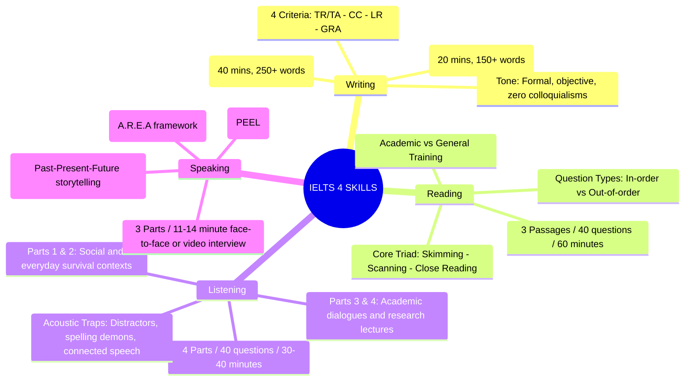

# Four Skills Master Blueprint: Writing – Reading – Listening – Speaking

Welcome to the comprehensive strategic mapping of the **IELTS Master Handbook**.

Achieving a top-tier IELTS band score (from a solid Band 5.0 foundation to an exceptional Band 7.5 – 8.5+) requires a lucid understanding of the distinct methodologies, assessment standards, and tactical workflows for each of the four core pillars: **Writing**, **Reading**, **Listening**, and **Speaking**.

---

## 1. ✍️ IELTS Writing: Logical Rigor & Academic Register

The IELTS Writing test evaluates your capacity to structure coherent arguments, synthesize complex data objectively, and demonstrate lexical and syntactic control within **60 minutes**.

### Test Structure & Strategy:
* **Writing Task 1 (Accounts for 1/3 of total Writing score — Recommended: 20 minutes):**
  * Requires a factual summary of at least **150 words** describing and comparing data presented in graphs, charts, tables, or process diagrams **without introducing personal speculation**.
  * **Core Visual Typologies:**
    * *Dynamic Trends Over Time:* [Line Graph](writing/task1-line-graph.md), [Bar Chart](writing/task1-bar-chart.md).
    * *Static Comparisons & Proportions:* [Pie Chart](writing/task1-pie-chart.md), [Table](writing/task1-table.md), [Mixed Chart](writing/task1-mixed.md).
    * *Spatial & Sequential Visuals:* [Process Diagrams (Natural & Industrial)](writing/task1-process.md), [Map Developments](writing/task1-map.md), [Architectural Floor Plans](writing/writing-task1-floor-plans-processes.md).
    * *Essential Toolkits:* [Master Task 1 Strategy](writing/task1-mastery.md), [Data Proportion Lexicon](writing/writing-task1-data-proportions.md), [Future Trend Projections](writing/writing-task1-future-projections.md).

* **Writing Task 2 (Accounts for 2/3 of total Writing score — Recommended: 40 minutes):**
  * Requires an academic discursive essay of at least **250 words** addressing a specific social prompt, hypothesis, or dilemma.
  * **5 Canonical Essay Formats:**
    * [Opinion (Agree or Disagree)](writing/task2-opinion.md): Maintain a firm, consistent stance from introduction to conclusion.
    * [Discuss Both Views](writing/task2-discussion.md): Impartially examine opposing perspectives before declaring a nuanced viewpoint.
    * [Advantages and Disadvantages](writing/task2-advantages-disadvantages.md): Evaluate weighted impacts (outweigh considerations).
    * [Problem and Solution](writing/task2-problem-solution.md): Diagnose structural root causes and propose pragmatic interventions.
    * [Two-Part Direct Questions](writing/task2-two-part.md): Formulate direct, comprehensive responses to both distinct prompt queries.
  * **Advanced Rhetorical & Grammatical Architectures:**
    * [PEEL Paragraph Architecture](writing/task2-peel-structure.md) (Point - Explanation - Example - Link).
    * [Prompt Paraphrasing & Direct Thesis Statements](writing/writing-paraphrase-thesis-intro.md).
    * [Academic Hedging & Nuanced Modality](writing/academic-hedging.md).
    * [Counter-Argument & Refutation Paragraphs](writing/writing-counter-argument-refutation.md).
    * [PESTLE Ideation Matrix](writing/writing-ideation-pestle.md) & [Thematic Progression Cohesion](writing/writing-cc-thematic-progression.md).

---

## 2. 📖 IELTS Reading: High-Speed Scanning & Synonymous Decoding

The Reading component comprises **3 dense academic passages** and **40 questions** to be completed in **60 minutes** with no separate answer transfer time.

### Core Strategic Methodologies:
1. **The Tactical Reading Triad:**
   * **Skimming:** Reading the introductory thesis and topic sentences within 90 seconds to establish a mental passage architecture.
   * **Scanning:** Pinpointing immutable anchor keywords (dates, proper nouns, scientific terminology).
   * **Close Reading:** Performing precise syntactic deconstruction on the targeted sentence and its immediate context.
2. **Mastering the 11 Core Question Types:**
   * [True / False / Not Given & Yes / No / Not Given Trap Demolition](reading/true-false-not-given.md).
   * [Matching Headings Tactics & Paragraph Topic Identification](reading/matching-headings.md).
   * [Summary Completion with a Box of Options](reading/reading-summary-box-options.md).
   * [Diagram & Flow-Chart Labelling Tactics](reading/reading-diagram-flowchart.md).
   * [Matching Information & Categorical Features](reading/reading-matching-info-features.md).
3. **Pacing & Cognitive Management:**
   * Allocate time strictly: **Passage 1 (15 mins)** $\rightarrow$ **Passage 2 (20 mins)** $\rightarrow$ **Passage 3 (25 mins)**.
   * Employ the [90-Second Rule](reading/reading-strategic-time-management.md) to abandon stubborn questions and eliminate time-drains.

---

## 3. 🎧 IELTS Listening: Acoustic Vigilance & Anti-Distractor Traps

The Listening module requires listening to 4 recorded audio sections played **once only**, answering 40 questions of progressive acoustic and conceptual difficulty.

### Strategic Section Blueprint:
* **Part 1 (Social Survival Dialogue):** Transactional exchanges (hotel reservations, memberships, bookings).
  * High-risk traps: [Alphabet & Postcode Spelling](listening/listening-part1-spelling-numbers.md), [Currency & Measurement Units](listening/spelling-and-units.md), [Top 100 Spelling Demons](listening/listening-spelling-demons-100.md).
* **Part 2 (Public Interest Monologue):** A single speaker delivering local orientation, tourist briefings, or museum layouts.
  * Tactical focus: [Map & Plan Labelling](listening/map-and-signposting.md), [Part 2 Map Directions](listening/listening-part2-map-directions.md).
* **Part 3 (Academic Research Dialogue):** 2 to 4 university students and an academic tutor discussing projects, theses, or experimental results.
  * Tactical focus: [Academic Multiple Choice & Conflict Traps](listening/listening-part3-academic-discussion.md), [Implicit Attitude & Tone Detection](listening/listening-part3-tone-attitude-sarcasm.md).
* **Part 4 (University Academic Lecture):** An uninterrupted, fast-paced lecture on scientific, historical, or environmental research.
  * Tactical focus: [Lecture Signpost Tracking](listening/listening-part4-lecture-signposting.md), [Connected Speech Decoding](listening/listening-connected-speech-phonetics.md).

---

## 4. 🗣️ IELTS Speaking: Conversational Spontaneity & Analytical Eloquence

The Speaking interview (11–14 minutes) assesses your communicative competence across 4 equal criteria: **Fluency & Coherence (FC)**, **Lexical Resource (LR)**, **Grammatical Range & Accuracy (GRA)**, and **Pronunciation (PR)**.

### The 3-Part Operational Framework:
* **Part 1 (Introduction & Everyday Topics - 4 to 5 minutes):**
  * Fast-paced, spontaneous responses using the [A.R.E.A Framework](speaking/area-framework-part1.md) (Answer - Reason - Example - Alternative).
  * Maintain fluid discourse using [50 Natural Fillers](speaking/natural-fillers.md) rather than silent hesitation.
* **Part 2 (The Individual Long Turn - 3 to 4 minutes):**
  * 1 minute of preparation followed by an uninterrupted 2-minute monologue.
  * Employ the [Past-Present-Future (PPF) Storytelling Timeline](speaking/storytelling-part2.md) or the [STAR Framework](speaking/speaking-part2-star-storytelling-method.md) to ensure structural balance.
* **Part 3 (Two-Way Academic Debate - 4 to 5 minutes):**
  * Shift from personal experiences to societal, philosophical, and macroeconomic considerations via the [Micro-to-Macro Social Expansion Shift](speaking/speaking-part3-micro-to-macro-social-expansion.md).
  * Utilize natural C1/C2 phrasal verbs and precise collocations via [Academic Collocations & Phrasal Verbs](speaking/speaking-natural-phrasal-verbs-collocations.md).

---

## 📚 5. Core Grammar & Vocabulary Foundations

Success across all four skills is anchored upon a robust foundation of grammatical precision and lexical sophistication:
- **Comprehensive Syntax Guide:** [Grammar & Academic Lexicon Overview](grammar-vocab/README.md)
- **Error Eradication Protocol:** [IELTS Error Log & Paraphrase Journal Template](grammar-vocab/error-log-and-paraphrase-journal.md)
- **Computer-Delivered Tactics:** [Platform Feature Overview](features/README.md)

---

*IELTS Master Handbook — Complete English Strategic Blueprint.*
