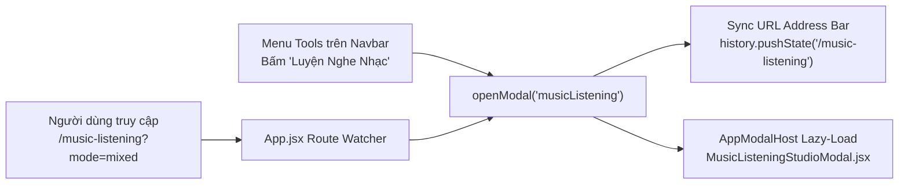
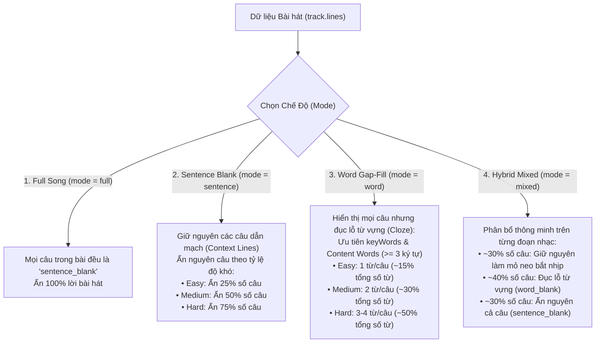

# KẾ HOẠCH NGHIÊN CỨU & XÂY DỰNG PHÂN HỆ LUYỆN NGHE NHẠC & CHÉP LỜI TIẾNG ANH (`MUSIC & LYRICS DICTATION STUDIO`)

> **Trạng thái tài liệu:** Bản kế hoạch kiến trúc & thiết kế kỹ thuật (Chưa triển khai code)  
> **Vị trí tích hợp:** Menu **Tools (Công Cụ)** trên thanh điều hướng `Navbar`  
> **Đường dẫn URL riêng:** `/music-listening` (hỗ trợ alias `/music-dictation`, `/luyen-nghe-nhac`, `#music-listening` và deep-linking qua query params)  
> **Hạ tầng lưu trữ Audio:** **Cloudflare R2** (`https://pub-b33ad70ef4c7465ea266bab37e4568fe.r2.dev/...`) kết hợp **IndexedDB** local cache.

---

## 1. TỔNG QUAN Ý TƯỞNG & MỤC TIÊU SƯ PHẠM

Phân hệ **Music & Lyrics Dictation Studio** giúp học viên rèn luyện phản xạ nghe tiếng Anh tự nhiên, nhận diện hiện tượng nối âm (Connected Speech), nuốt âm (Elision), dạng yếu (Weak Forms) và tăng tốc độ gõ chính tả thông qua các bài hát tiếng Anh lưu trữ trên **Cloudflare R2**.

### 4 Chế độ Luyện tập Cốt lõi (4 Core Practice Modes)
1. **Chế độ 1 — Chép Nguyên Bài (`Full Song Dictation` / `mode=full`):**  
   Ẩn toàn bộ lời bài hát. Người học nghe từng dòng nhạc (theo mốc timestamp `[MM:SS]`) hoặc nghe toàn bài và gõ lại đầy đủ từng câu từ đầu đến cuối bài.
2. **Chế độ 2 — Để Trống Câu Để Chép Nguyên Câu (`Sentence Blank Dictation` / `mode=sentence`):**  
   Hiển thị lời bài hát làm mạch dẫn (context lines) để người học dễ theo dõi nhịp nhạc, nhưng **để trống hoàn toàn một số câu mục tiêu**. Khi nhạc phát tới câu trống, người học phải nghe và chép lại trọn vẹn cả câu đó.
3. **Chế độ 3 — Để Trống Từ Để Điền (`Word Gap-Fill / Cloze Lyrics` / `mode=word`):**  
   Hiển thị lời bài hát nhưng đục lỗ các từ/cụm từ quan trọng ngay trong câu (Inline inputs). Người học nghe nhạc và điền đúng từ còn thiếu vào chỗ trống theo thời gian thực.
4. **Chế độ 4 — Kết Hợp Trống Cả Câu Và Cả Từ (`Hybrid Mixed Mode` / `mode=mixed`):**  
   Trong cùng một bài hát, hệ thống kết hợp xen kẽ:
   - Các câu giữ nguyên lời (Anchor lines) để bắt nhịp nhạc.
   - Các câu **đục lỗ từ vựng (`word_blank`)** để bắt từ khóa nhanh.
   - Các câu **để trống nguyên câu (`sentence_blank`)** ở những câu đắt giá/điệp khúc để thử thách trí nhớ ngắn hạn (Working Memory) và khả năng chép chính tả toàn câu.

---

## 2. RÀ SOÁT KẾ THỪA TỪ WEBSITE HIỆN TẠI (REUSE & INHERITANCE AUDIT)

Qua quá trình rà soát toàn bộ mã nguồn hiện tại của **IELTS Web**, chúng ta có thể **kế thừa trực tiếp từ 85% đến 100% hạ tầng lõi** mà không cần viết lại từ đầu:

### 2.1. Bảng Ma trận Kế thừa Kỹ thuật

| Thành phần / Tính năng cần có | File hiện có trong Codebase | Mức độ kế thừa | Cách thức kế thừa & Mở rộng cho Music Listening Studio |
| :--- | :--- | :---: | :--- |
| **1. Lưu trữ & Quản lý file nhạc trên Cloudflare R2** | [`scripts/r2_audio_manager.js`](file:///c:/Projects/IELTS%20Web/scripts/r2_audio_manager.js)<br>[`docs/AUDIO_PROCESSING_PROTOCOL.md`](file:///c:/Projects/IELTS%20Web/docs/AUDIO_PROCESSING_PROTOCOL.md) | **100%** | • Tái sử dụng trực tiếp hàm `uploadAudioToR2(localFilePath, destinationKey)` để đẩy file `.mp3` lên bucket `ielts-audio-storage` (`https://pub-b33ad70ef4c7465ea266bab37e4568fe.r2.dev/<key>`).<br>• Đặt quy ước tiền tố key trên R2: `music-<slug>.mp3` để dễ phân loại với `ielts-listening-track*.mp3`.<br>• Hưởng trọn vẹn ưu thế **$0 phí băng thông Egress** và header `Accept-Ranges: bytes` giúp tua tới mọi câu hát trong `< 15ms`. |
| **2. Bộ máy Phát âm thanh HTML5 Audio Engine** | [`src/hooks/useAudioEngine.js`](file:///c:/Projects/IELTS%20Web/src/hooks/useAudioEngine.js)<br>[`src/components/listening/AudioPlayerBar.jsx`](file:///c:/Projects/IELTS%20Web/src/components/listening/AudioPlayerBar.jsx) | **90%** | • Kế thừa nguyên vẹn state machine (`idle`, `loading`, `ready`, `playing`, `paused`, `ended`, `error`), thanh tiến trình `bufferedPercent`, tốc độ phát (`0.75x`, `0.85x`, `1.0x`, `1.15x`), tắt/bật tiếng và cơ chế tự động chuyển `fallbackSrc` nếu lỗi mạng.<br>• **Mở rộng thêm:** Chế độ **Line Loop (Lặp lại câu đang nghe)** và **Auto-Pause at Line End (Tự dừng cuối câu)** phục vụ riêng cho lúc gõ chép lời. |
| **3. Bộ phân tích Lời bài hát & Mốc thời gian (LRC / Timestamp Parser)** | [`src/utils/transcriptParser.js`](file:///c:/Projects/IELTS%20Web/src/utils/transcriptParser.js) | **95%** | • Hàm `parseTranscriptStringToKaraoke()` và `parseTimestampToSeconds()` hiện tại đã đọc định dạng `[MM:SS.xx] Nội dung` — **trùng khớp 100% với định dạng file lời bài hát quốc tế `.LRC`**!<br>• Có thể nạp trực tiếp lời bài hát dạng chuỗi `[00:14.20] I found a love for me...` và tự động tách thành mảng các dòng `{ start, end, text }` mà không cần công cụ chuyển đổi phức tạp. |
| **4. Đồng bộ Karaoke Thời gian thực & Cuộn tự động** | [`src/components/listening/ListeningTranscriptModal.jsx`](file:///c:/Projects/IELTS%20Web/src/components/listening/ListeningTranscriptModal.jsx) | **90%** | • Kế thừa logic `currentSentenceIdx` (so sánh `audioEngine.currentTime >= line.start && audioEngine.currentTime < line.end`) và `activeSentenceRef.current.scrollIntoView({ behavior: 'smooth', block: 'nearest' })` để tự động cuộn bài hát theo giai điệu đang phát. |
| **5. Thuật toán So khớp & Chấm điểm Chép chính tả (LCS Diff Engine)** | [`src/utils/dictationDiff.js`](file:///c:/Projects/IELTS%20Web/src/utils/dictationDiff.js) | **100%** | • Kế thừa trực tiếp `normalizeWord()` (chuẩn hóa chữ hoa/thường, dấu câu, dấu nháy đơn `don't` = `dont`, `I'm` = `Im`) và `computeDictationDiff(targetSentence, userSentence)`.<br>• Dùng để chấm điểm tức thì cho **Chế độ 1 (Chép nguyên bài)**, **Chế độ 2 (Trống nguyên câu)** và các câu trống trong **Chế độ 4 (Kết hợp)**, chỉ rõ từng từ đúng (`correct`), từ bỏ sót (`missed`) và từ gõ thừa/sai (`extra`). |
| **6. Chẩn đoán Lỗi Chính tả nhẹ & Thiếu âm đuôi `-s/-ed`** | [`src/utils/listeningScorer.js`](file:///c:/Projects/IELTS%20Web/src/utils/listeningScorer.js) | **85%** | • Kế thừa hàm khoảng cách `levenshtein(a, b)` và `checkPluralDiscrepancy()` để dùng cho **Chế độ 3 (Điền từ)**.<br>• Khi người dùng gõ từ sai 1 ký tự (typo) hoặc thiếu đuôi `s/es/ed`, ô input sẽ cảnh báo màu vàng (*"Gần đúng! Kiểm tra lại chính tả hoặc âm đuôi"*), tạo trải nghiệm học tập khích lệ hơn. |
| **7. Bộ sinh Đề Ngẫu nhiên Xác định (Deterministic PRNG)** | [`src/utils/seededRandom.js`](file:///c:/Projects/IELTS%20Web/src/utils/seededRandom.js) | **100%** | • Kế thừa `hashString()` và `createMulberry32(seed)` để tự động chọn câu ẩn / từ ẩn theo mức độ khó (`Easy`, `Medium`, `Hard`) một cách nhất quán hoặc tạo đề ngẫu nhiên mới mỗi lượt chơi (`Shuffle Blanks`). |
| **8. Lưu trữ Audio Cá nhân Offline (IndexedDB)** | [`src/utils/audioStorage.js`](file:///c:/Projects/IELTS%20Web/src/utils/audioStorage.js) | **100%** | • Kế thừa `saveAudioBlob` và `getAudioPlayableUrl` để cho phép người dùng tự tải file nhạc `.mp3` kèm lời `.lrc`/text từ máy tính lên luyện cá nhân ngay trên trình duyệt mà không tốn dung lượng cloud. |
| **9. Hệ thống URL Routing 2 chiều & Modal Store** | [`src/core/modalStore.js`](file:///c:/Projects/IELTS%20Web/src/core/modalStore.js)<br>[`src/components/modals/AppModalHost.jsx`](file:///c:/Projects/IELTS%20Web/src/components/modals/AppModalHost.jsx)<br>[`src/App.jsx`](file:///c:/Projects/IELTS%20Web/src/App.jsx)<br>[`vercel.json`](file:///c:/Projects/IELTS%20Web/vercel.json) | **100%** | • Kế thừa kiến trúc Two-Way URL Routing đã áp dụng cực kỳ ổn định cho `/pronunciation`, `/conversation`, `/vocab-studio`, `/micro-drills`.<br>• Rule `rewrites` trong `vercel.json` đã hỗ trợ sẵn mọi đường dẫn SPA, nên `/music-listening` sẽ hoạt động ngay khi F5 hoặc truy cập trực tiếp từ link chia sẻ. |
| **10. Tích hợp Sổ tay Từ vựng, Luyện phát âm & Gamification XP** | [`src/utils/vocabDuplicate.js`](file:///c:/Projects/IELTS%20Web/src/utils/vocabDuplicate.js)<br>[`src/services/gamification/atlasWalletService.js`](file:///c:/Projects/IELTS%20Web/src/services/gamification/atlasWalletService.js) | **100%** | • Cho phép lưu từ mới/idiom trong bài hát vào **Sổ Tay Từ Vựng (`/vocab-vault`)** bằng 1 cú nhấp chuột.<br>• Nút chuyển câu hát sang **Phòng Luyện Phát Âm (`/pronunciation`)** hoặc **Shadowing (`/conversation`)**.<br>• Cộng XP & Atlas Gold khi hoàn thành bài nhạc. |

---

## 3. KIẾN TRÚC ĐIỀU HƯỚNG & ĐƯỜNG DẪN URL RIÊNG

### 3.1. Vị trí trong Menu `Tools` (Công Cụ) trên `Navbar.jsx`
Thêm mục mới trong dropdown **Tools (Công Cụ)** trên Desktop và ngăn kéo **Mobile Drawer**:
- **Icon:** `Music` (từ `lucide-react`) với tông màu `rose/pink` hoặc `violet` nổi bật.
- **Tên hiển thị:**
  - Tiếng Việt (`!isEn`): **Luyện Nghe Nhạc & Chép Lời** — Phụ đề: *Chép nguyên bài, điền câu & điền từ qua nhạc Anh (/music-listening)*
  - Tiếng Anh (`isEn`): **Music & Lyrics Dictation** — Phụ đề: *Full song, sentence & word gap-fill via music (/music-listening)*
- **Badge:** `NEW` / `MỚI` hoặc `+XP`.

### 3.2. Thiết kế URL Riêng & Deep-Linking (`src/App.jsx`)
Hỗ trợ đồng bộ 2 chiều giữa thanh địa chỉ trình duyệt (`window.history.pushState` / `popstate`) và `modalStore` (`modals.musicListening`):
- **Đường dẫn chính:** `/music-listening`
- **Các đường dẫn đồng nghĩa (Aliases):** `/music-dictation`, `/lyrics-training`, `/luyen-nghe-nhac`, `#music-listening`
- **Hỗ trợ Query Parameters để chia sẻ trực tiếp bài hát & chế độ:**
  - `/music-listening?song=ed-sheeran-perfect&mode=mixed&level=medium`
  - `song`: ID của bài hát trong ngân hàng nhạc R2.
  - `mode`: `full` (Chép nguyên bài) | `sentence` (Trống nguyên câu) | `word` (Trống từ) | `mixed` (Kết hợp cả câu & từ).
  - `level`: `easy` (Dễ - ẩn ~20%) | `medium` (Vừa - ẩn ~40%) | `hard` (Khó - ẩn ~65%).



---

## 4. THIẾT KẾ CẤU TRÚC DỮ LIỆU BÀI HÁT & THUẬT TOÁN SINH ĐỀ 4 CHẾ ĐỘ

### 4.1. Cấu trúc Dữ liệu Bài hát Chuẩn hóa (`src/data/musicListeningData.js`)
Tuân thủ tuyệt đối quy tắc **Strict Global English UI Rule** trong `GEMINI.md` (mọi trường giải thích, tiêu đề, ghi chú ngữ pháp, từ vựng đều có bản tiếng Anh `En` và bản tiếng Việt `Vi`):

```javascript
export const MUSIC_LISTENING_TRACKS = [
  {
    id: 'music-track-01-acoustic-story',
    title: 'A Thousand Miles of Light',
    artist: 'Cambridge Acoustic Sessions',
    genreEn: 'Acoustic Pop / Ballad',
    genreVi: 'Nhạc Pop Acoustic / Ballad nhẹ nhàng',
    bandTarget: '5.0 - 7.5+',
    bpm: 92, // Tốc độ nhịp bài hát (giúp phân loại Nhạc chậm / Vừa / Nhanh)
    accent: 'British / International Pop',
    source: 'cloudflare_r2',
    audioUrl: 'https://pub-b33ad70ef4c7465ea266bab37e4568fe.r2.dev/music-track-01-acoustic-story.mp3',
    fallbackAudioUrl: 'https://pub-b33ad70ef4c7465ea266bab37e4568fe.r2.dev/music-track-01-acoustic-story.mp3',
    audioDuration: 215,
    coverGradient: 'from-rose-500 via-purple-600 to-indigo-700',
    pedagogicalFocusEn: 'Connected speech (linking consonant to vowel), past tense endings (-ed), and emotional collocations.',
    pedagogicalFocusVi: 'Luyện nghe nối âm (phụ âm nối nguyên âm), âm đuôi quá khứ (-ed) và cụm từ vựng giàu cảm xúc.',
    
    // Danh sách lời bài hát có mốc thời gian chuẩn (tương thích 100% với transcriptParser.js)
    lines: [
      {
        id: 'line-1',
        index: 0,
        sectionEn: 'Verse 1',
        sectionVi: 'Lời 1 (Verse 1)',
        start: 12.5,
        end: 16.8,
        text: 'Walking through the quiet streets of London in the rain',
        translationVi: 'Bước đi qua những con phố yên tĩnh của Luân Đôn dưới cơn mưa',
        // Gợi ý từ đắt giá ưu tiên đục lỗ ở chế độ Điền từ (Word Mode)
        keyWords: ['quiet', 'streets', 'rain'],
        // Đánh dấu câu ưu tiên ẩn cả câu ở chế độ Trống câu (Sentence Mode) hoặc Kết hợp (Mixed Mode)
        isKeySentence: false,
        phoneticNoteEn: '"Walking through" links smoothly; "streets of" sounds like /striːts_əv/.',
        phoneticNoteVi: 'Cụm "streets of" được đọc nối âm và giảm âm thành /striːts_əv/.'
      }
      // ... các câu tiếp theo
    ],

    // Danh sách từ vựng / cấu trúc hay trong bài để lưu 1 chạm vào Vocabulary Notebook
    vocabHighlights: [
      {
        word: 'quiet streets',
        phonetic: '/ˈkwaɪ.ət striːts/',
        meaningEn: 'Calm roads with very little traffic or noise',
        meaningVi: 'Những con phố vắng lặng, ít tiếng ồn',
        example: 'Walking through the quiet streets of London in the rain.'
      }
    ]
  }
];
```

### 4.2. Thuật toán Sinh Bài Tập cho 4 Chế Độ (`src/utils/musicDictationGenerator.js`)

Để bài hát không bị nhàm chán khi nghe lại nhiều lần, ta thiết kế bộ sinh bài tập (`generateMusicExercise(track, mode, difficulty, seed)`) hỗ trợ cả **Chế độ Đề chuẩn Sư phạm (`curated`)** và **Chế độ Xáo trộn thông minh (`random_seed`)**:



#### Chi tiết Quy tắc Chọn Từ & Chọn Câu Thông Minh:
1. **Quy tắc chọn từ đục lỗ (`Word Blank Selector`):**
   - Ưu tiên các từ nằm trong mảng `line.keyWords` do biên tập viên chỉ định.
   - Khi cần đục thêm từ theo độ khó `Medium` / `Hard` hoặc khi người dùng bấm **"Đổi vị trí ô trống (Shuffle Blanks)"**, thuật toán ưu tiên chọn **Content Words** (danh từ, động từ, tính từ, trạng từ có độ dài `>= 4` ký tự), hạn chế đục các mạo từ/giới từ quá ngắn (`a`, `to`, `in`) ở mức `Easy`, nhưng cho phép đục cả cụm giới từ/nối âm (`want to`, `kind of`, `out of`) ở mức `Hard` để luyện nghe Connected Speech.
2. **Quy tắc chống "Lạc nhịp nhạc" ở Chế độ Trống câu & Kết hợp (`Anti-Drift Rule`):**
   - Ở chế độ **Trống câu (`sentence`)** và **Kết hợp (`mixed`)**, câu đầu tiên của bài hát (`lineIndex === 0`) luôn được hiển thị (hoặc chỉ đục 1 từ cuối câu) để người học bắt được thời điểm ca sĩ bắt đầu hát sau đoạn nhạc dạo (Intro).
   - Không bao giờ xếp quá 2 câu `sentence_blank` liên tiếp ở mức `Easy/Medium`, giúp người học luôn có câu dẫn mỏ neo trước và sau câu phải chép.

---

## 5. THIẾT KẾ GIAO DIỆN & TRẢI NGHIỆM NGƯỜI DÙNG (UI/UX WORKSPACE)

Giao diện `MusicListeningStudioModal.jsx` được thiết kế dạng Fullscreen Studio hiện đại, tối ưu cho cả máy tính (Split-pane) và điện thoại (Sticky Player + Scrollable Lyrics):

### 5.1. Bố cục Màn hình (3 Khu vực Chính)
1. **Thanh Header & Bộ chọn Chế độ (Top Studio Bar):**
   - Chọn bài hát từ thư viện R2 (lọc theo tốc độ BPM: *Chậm dễ nghe*, *Trung bình*, *Nhanh* hoặc theo Target Band).
   - **Thanh chuyển đổi 4 Chế độ 1-Chạm (4-Mode Segmented Control):**
     - `📝 Chép Nguyên Bài (Full Song)`
     - `💬 Trống Nguyên Câu (Sentence Blanks)`
     - `🧩 Điền Từ Trống (Word Blanks)`
     - `⚡ Kết Hợp Câu & Từ (Hybrid Mixed)`
   - **Bộ chọn Độ khó & Nút Xáo Đề:** `Easy (20%)` | `Medium (40%)` | `Hard (65%)` + Nút `🎲 Đổi vị trí trống (Shuffle)`.
   - Nút `➕ Tự nạp nhạc & lời (Custom Song / LRC)` cho phép người học dán lời bài hát bất kỳ hoặc dùng file `.mp3` cá nhân.

2. **Bàn Điều Khiển Âm Nhạc Chuyên Dụng Cho Chép Lời (Smart Dictation Player Bar):**
   - Kế thừa từ `AudioPlayerBar.jsx` nhưng bổ sung **3 công tắc vàng cho người luyện chép chính tả**:
     - 🔁 **Auto-Loop Line (Tự lặp câu hiện tại):** Tự động phát đi phát lại đúng câu đang focus (`line.start` ➔ `line.end`) cho đến khi người dùng gõ xong và bấm `Enter`.
     - ⏸️ **Auto-Pause at Line End (Tự dừng cuối câu):** Khi hết câu, nhạc tự dừng lại chờ người dùng gõ xong toàn bộ câu rồi mới phát tiếp câu sau.
     - 🐢 **Tốc độ phát linh hoạt:** `0.75x` (Tách âm rõ từng chữ), `0.85x`, `1.0x` (Chuẩn gốc), `1.15x`.
   - **Hệ thống Phím tắt Bàn phím (Hands-Free Dictation Shortcuts):**
     - `Tab` hoặc `Ctrl + Space`: Nghe lại ngay câu hiện tại từ đầu câu (`seek(currentLine.start)`).
     - `Enter`: Kiểm tra nhanh câu/từ vừa gõ và tự động nhảy con trỏ sang ô trống/câu trống tiếp theo.
     - `Ctrl + H` (hoặc nút `💡 Gợi ý`): Hiện chữ cái đầu tiên của từ đang bí hoặc phát chậm câu đó ở tốc độ `0.75x`.

3. **Khung Lời Bài Hát Tương Tác (Interactive Karaoke & Dictation Canvas):**
   - Mỗi dòng nhạc hiển thị mốc thời gian `[00:15]` (bấm vào để tua tới câu đó), trạng thái câu (Đang phát / Đã hoàn thành / Còn trống), và nội dung theo đúng chế độ:
     - **Với dòng hiển thị nguyên vẹn (Anchor Line):** Chữ sáng lên mượt mà theo hiệu ứng Karaoke khi ca sĩ hát qua.
     - **Với dòng Điền từ (`word_blank`):** Hiển thị câu hát kèm các ô input inline `[ _______ ]` có chiều rộng tự co giãn theo độ dài từ gốc. Gõ đúng từ tự động chuyển màu xanh ngọc (`emerald`) và nhảy sang ô tiếp theo; gõ sai chính tả nhẹ (Levenshtein = 1) hiện viền vàng gợi ý sửa.
     - **Với dòng Chép nguyên câu (`sentence_blank`):** Hiển thị khung nhập câu (`Sentence Dictation Input`) kèm gợi ý số lượng từ trong câu (ví dụ: *9 words / 9 từ*). Khi người học gõ và bấm `Enter` (hoặc bấm `Chấm bài`), hệ thống chạy `computeDictationDiff()` hiển thị đối chiếu từng từ ngay bên dưới dòng đó.
   - **Chế độ Xem Giải Thích & Học Từ Vựng Sau Khi Điền Xong 1 Câu:**
     - Ngay khi hoàn thành một câu, người học có thể bật xem bản dịch nghĩa tiếng Việt (`translationVi`), giải thích hiện tượng nối âm/nuốt âm (`phoneticNoteEn` / `phoneticNoteVi`), hoặc bấm lưu từ vựng vào **Sổ Tay Từ Vựng**.

---

## 6. QUY TRÌNH LƯU TRỮ & NẠP NHẠC LÊN CLOUDFLARE R2

Tận dụng 100% quy trình `scripts/r2_audio_manager.js` hiện có của dự án:

1. **Chuẩn bị file âm nhạc (`.mp3`):**
   - Chuẩn hóa bitrate `128kbps - 192kbps MP3` (mỗi bài hát 3–4 phút chỉ nặng khoảng `2.5 MB – 3.5 MB`, tải tức thì trên cả mạng 4G di động).
2. **Đẩy file lên Cloudflare R2:**
   ```powershell
   node scripts/r2_audio_manager.js upload "path/to/song.mp3" "music-track-01-song-name.mp3"
   ```
   - Script trả về URL công khai: `https://pub-b33ad70ef4c7465ea266bab37e4568fe.r2.dev/music-track-01-song-name.mp3`.
3. **Nạp lời bài hát & Timestamp (`.lrc` hoặc Timestamped Text):**
   - Nhờ kế thừa `parseTranscriptStringToKaraoke()` trong `src/utils/transcriptParser.js`, bạn chỉ cần dán nội dung lời bài hát chuẩn `.lrc` (có sẵn rất nhiều cho mọi bài hát tiếng Anh dạng `[00:12.40] Lyric line...`), hệ thống sẽ tự động tính toán `start` và `end` cho từng câu hát.

---

## 7. LỘ TRÌNH TRIỂN KHAI TỪNG BƯỚC (IMPLEMENTATION ROADMAP)

Khi bạn duyệt kế hoạch này và yêu cầu bắt đầu code, quá trình triển khai sẽ chia làm **4 Bước gọn gàng, an toàn**:

### Bước 1: Xây dựng Tầng Dữ liệu & Bộ Sinh Bài Tập 4 Chế Độ (Data & Generator Engine)
- **Tạo mới [`src/utils/musicDictationGenerator.js`](file:///c:/Projects/IELTS%20Web/src/utils/musicDictationGenerator.js):**
  - Viết hàm chuyển đổi lời bài hát thành bài tập theo 4 chế độ (`full`, `sentence`, `word`, `mixed`) và 3 cấp độ khó (`easy`, `medium`, `hard`), kết hợp `seededRandom.js`, `dictationDiff.js` và `listeningScorer.js`.
  - Hỗ trợ trình nhập lời bài hát định dạng `.LRC` / `[MM:SS]` thông qua `transcriptParser.js`.
- **Tạo mới [`src/data/musicListeningData.js`](file:///c:/Projects/IELTS%20Web/src/data/musicListeningData.js):**
  - Thiết lập danh sách bài hát mẫu trên Cloudflare R2 (kèm khả năng tận dụng các file audio chất lượng cao sẵn có trên R2 và các file nhạc bạn upload thêm), đầy đủ timestamps, ghi chú nối âm (`phoneticNoteEn/Vi`), từ vựng (`vocabHighlights`) và song ngữ 100% chuẩn Strict Global English UI.

### Bước 2: Xây dựng Giao diện `MusicListeningStudioModal.jsx` & Mở rộng Audio Controls
- **Tạo mới [`src/components/MusicListeningStudioModal.jsx`](file:///c:/Projects/IELTS%20Web/src/components/MusicListeningStudioModal.jsx):**
  - Giao diện chọn bài hát, chuyển đổi 4 chế độ (`Chép nguyên bài`, `Trống câu`, `Trống từ`, `Kết hợp`), chọn độ khó, nút xáo vị trí trống (`Shuffle`).
  - Tích hợp `useAudioEngine` kèm tính năng **Auto-Loop Line** (lặp câu đang gõ), **Auto-Pause at Line End** (tự dừng cuối câu), phím tắt `Tab` nghe lại câu và `Enter` chấm câu.
  - Khung làm bài tương tác hỗ trợ cả **Inline Word Inputs** (điền từ), **Sentence Dictation Boxes** (chép nguyên câu) và **Full Song Canvas** (chép cả bài).
  - Bảng tổng kết kết quả (Độ chính xác %, số từ/câu đúng, thời gian hoàn thành, thưởng XP & Atlas Gold, lưu từ vựng vào Sổ tay).
  - Tính năng **Custom Song Practice**: Cho phép người dùng/Admin tải file `.mp3` hoặc dán link R2 + lời bài hát `.lrc` để tự tạo bài luyện nhạc mới ngay trên giao diện.

### Bước 3: Kết nối Hệ thống Điều hướng (`Navbar`, `modalStore`, `AppModalHost`, URL `/music-listening`)
- **Cập nhật [`src/core/modalStore.js`](file:///c:/Projects/IELTS%20Web/src/core/modalStore.js):** Thêm state `musicListening: false`.
- **Cập nhật [`src/components/modals/AppModalHost.jsx`](file:///c:/Projects/IELTS%20Web/src/components/modals/AppModalHost.jsx):** Lazy-load `MusicListeningStudioModal` và truyền `vocabList`, `currentUser`, `onSaveToNotebook`.
- **Cập nhật [`src/components/Navbar.jsx`](file:///c:/Projects/IELTS%20Web/src/components/Navbar.jsx):** Thêm mục **"Luyện Nghe Nhạc & Chép Lời" / "Music & Lyrics Dictation" (`/music-listening`)** vào menu **Tools (Công Cụ)** trên cả Desktop và Mobile Drawer.
- **Cập nhật [`src/App.jsx`](file:///c:/Projects/IELTS%20Web/src/App.jsx):** Thêm `useEffect` đồng bộ 2 chiều cho đường dẫn `/music-listening` (kèm query `?song=...&mode=...&level=...`).
- **Cập nhật [`src/core/featureRegistry.js`](file:///c:/Projects/IELTS%20Web/src/core/featureRegistry.js) & [`src/core/featureLocalization.js`](file:///c:/Projects/IELTS%20Web/src/core/featureLocalization.js):** Đăng ký tính năng vào trung tâm trợ giúp F1 và Spotlight Search.

### Bước 4: Kiểm thử Tự động (Unit Tests & Strict English UI Check)
- Kiểm tra toàn bộ 4 chế độ (`full`, `sentence`, `word`, `mixed`), phím tắt tua/lặp câu, đồng bộ URL `/music-listening` và kiểm tra 100% không xuất hiện chữ tiếng Việt khi `isEn === true`.
