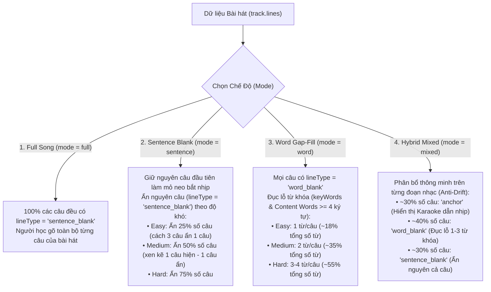
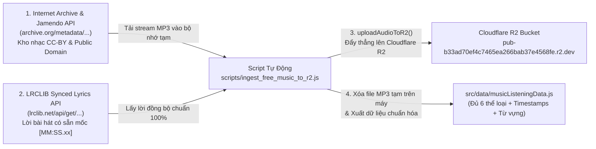

# KẾ HOẠCH NGHIÊN CỨU & XÂY DỰNG PHÂN HỆ LUYỆN NGHE NHẠC & CHÉP LỜI TIẾNG ANH (`MUSIC & LYRICS DICTATION STUDIO`)

> **Trạng thái tài liệu:** Bản kế hoạch kiến trúc & thiết kế kỹ thuật (Đã rà soát tối ưu UI/UX & Kiến trúc Phần mềm — Chưa triển khai code)  
> **Vị trí tích hợp:** Menu **Tools (Công Cụ)** trên thanh điều hướng `Navbar`  
> **Đường dẫn URL riêng:** `/music-listening` (hỗ trợ alias `/music-dictation`, `/luyen-nghe-nhac`, `#music-listening` và deep-linking qua query params)  
> **Hạ tầng lưu trữ Audio:** **Cloudflare R2** (`https://pub-b33ad70ef4c7465ea266bab37e4568fe.r2.dev/...`) kết hợp **IndexedDB** local cache.

---

## 1. TỔNG QUAN Ý TƯỞNG & MỤC TIÊU SƯ PHẠM

Phân hệ **Music & Lyrics Dictation Studio** giúp học viên rèn luyện phản xạ nghe tiếng Anh tự nhiên, nhận diện hiện tượng nối âm (Connected Speech), nuốt âm (Elision), dạng yếu (Weak Forms) và tăng tốc độ gõ chính tả thông qua các bài hát tiếng Anh đa thể loại lưu trữ trên **Cloudflare R2**.

### 4 Chế độ Luyện tập Cốt lõi (4 Core Practice Modes)
1. **Chế độ 1 — Chép Nguyên Bài (`Full Song Dictation` / `mode=full`):**  
   Ẩn 100% lời bài hát. Người học nghe từng dòng nhạc (theo mốc timestamp `[MM:SS]`) với chế độ tự lặp câu hoặc tự dừng cuối câu và gõ lại đầy đủ từng câu từ đầu đến cuối bài.
2. **Chế độ 2 — Để Trống Câu Để Chép Nguyên Câu (`Sentence Blank Dictation` / `mode=sentence`):**  
   Hiển thị các câu dẫn mạch (Anchor lines) chạy hiệu ứng Karaoke để người học dễ theo dõi nhịp nhạc, nhưng **để trống hoàn toàn một số câu mục tiêu**. Khi nhạc phát tới câu trống, khung nhập tự động focus để người học nghe và chép lại trọn vẹn cả câu đó.
3. **Chế độ 3 — Để Trống Từ Để Điền (`Word Gap-Fill / Cloze Lyrics` / `mode=word`):**  
   Hiển thị lời bài hát nhưng đục lỗ các từ/cụm từ quan trọng ngay trong câu (Inline inputs). Người học nghe nhạc và điền đúng từ còn thiếu vào chỗ trống theo thời gian thực.
4. **Chế độ 4 — Kết Hợp Trống Cả Câu Và Cả Từ (`Hybrid Mixed Mode` / `mode=mixed`):**  
   Trong cùng một bài hát, hệ thống kết hợp xen kẽ:
   - Các câu giữ nguyên lời (~30% - Anchor lines) để bắt nhịp nhạc.
   - Các câu **đục lỗ từ vựng (~40% - `word_blank`)** để bắt từ khóa nhanh.
   - Các câu **để trống nguyên câu (~30% - `sentence_blank`)** ở những câu đắt giá/điệp khúc để thử thách trí nhớ ngắn hạn (Working Memory) và khả năng chép chính tả toàn câu.

---

## 2. RÀ SOÁT KẾ THỪA TỪ WEBSITE HIỆN TẠI (REUSE & INHERITANCE AUDIT)

Qua quá trình rà soát toàn bộ mã nguồn hiện tại của **IELTS Web**, phân hệ mới có thể **kế thừa trực tiếp từ 85% đến 100% hạ tầng lõi** mà không cần viết lại từ đầu:

| Thành phần / Tính năng | File hiện có trong Codebase | Mức độ kế thừa | Cách thức kế thừa & Mở rộng cho Music Listening Studio |
| :--- | :--- | :---: | :--- |
| **1. Lưu trữ & Quản lý file nhạc trên Cloudflare R2** | [`scripts/r2_audio_manager.js`](file:///c:/Projects/IELTS%20Web/scripts/r2_audio_manager.js)<br>[`docs/AUDIO_PROCESSING_PROTOCOL.md`](file:///c:/Projects/IELTS%20Web/docs/AUDIO_PROCESSING_PROTOCOL.md) | **100%** | • Tái sử dụng trực tiếp hàm `uploadAudioToR2(localFilePath, destinationKey)` để đẩy file `.mp3` lên bucket `ielts-audio-storage` (`https://pub-b33ad70ef4c7465ea266bab37e4568fe.r2.dev/<key>`).<br>• Đặt quy ước tiền tố key trên R2: `music-<genre>-<slug>.mp3` để tách biệt rõ với `ielts-listening-track*.mp3`.<br>• Hưởng trọn vẹn ưu thế **$0 phí băng thông Egress** và header `Accept-Ranges: bytes` giúp tua tới mọi câu hát trong `< 15ms`. |
| **2. Bộ máy Phát âm thanh HTML5 Audio Engine** | [`src/hooks/useAudioEngine.js`](file:///c:/Projects/IELTS%20Web/src/hooks/useAudioEngine.js)<br>[`src/components/listening/AudioPlayerBar.jsx`](file:///c:/Projects/IELTS%20Web/src/components/listening/AudioPlayerBar.jsx) | **90%** | • Kế thừa nguyên vẹn state machine (`idle`, `loading`, `ready`, `playing`, `paused`, `ended`, `error`), thanh tiến trình `bufferedPercent`, tốc độ phát (`0.75x`, `0.85x`, `1.0x`, `1.15x`), tắt/bật tiếng và cơ chế tự động chuyển `fallbackSrc` nếu lỗi mạng.<br>• **Mở rộng thêm:** Chế độ **A-B Line Loop (Lặp lại câu đang nghe)** và **Auto-Pause at Line End (Tự dừng cuối câu)** phục vụ riêng cho lúc gõ chép lời. |
| **3. Bộ phân tích Lời bài hát & Mốc thời gian (`.LRC` Parser)** | [`src/utils/transcriptParser.js`](file:///c:/Projects/IELTS%20Web/src/utils/transcriptParser.js) | **95%** | • Hàm `parseTranscriptStringToKaraoke()` và `parseTimestampToSeconds()` hiện tại đã đọc định dạng `[MM:SS.xx] Nội dung` — **trùng khớp 100% với định dạng file lời bài hát quốc tế `.LRC`**.<br>• Nạp trực tiếp chuỗi `.lrc` `[00:14.20] Lyric line...` và tự động tách thành mảng `{ start, end, text }`. |
| **4. Thuật toán So khớp & Chấm điểm Chép nguyên câu / nguyên bài** | [`src/utils/dictationDiff.js`](file:///c:/Projects/IELTS%20Web/src/utils/dictationDiff.js) | **100%** | • Kế thừa trực tiếp `normalizeWord()` (bỏ qua hoa/thường, dấu câu, chuẩn hóa dấu nháy đơn `don't` ↔ `dont`, `I'm` ↔ `Im`) và quy hoạch động LCS `computeDictationDiff(targetSentence, userSentence)`.<br>• Trả về chi tiết từng từ đúng (`correct`), từ bỏ sót (`missed`/`omission`), từ gõ thừa/sai (`extra`) và `% accuracy`. |
| **5. Chẩn đoán Lỗi Chính tả nhẹ (Near-Miss) & Âm đuôi `-s/-ed`** | [`src/utils/listeningScorer.js`](file:///c:/Projects/IELTS%20Web/src/utils/listeningScorer.js) | **85%** | • Kế thừa hàm khoảng cách `levenshtein(a, b)` và `checkPluralDiscrepancy()` cho các ô điền từ (`word_blank`).<br>• Khi người dùng gõ sai 1 ký tự (typo) hoặc thiếu đuôi `s/es/ed`, ô input cảnh báo viền vàng (*"Near match! Check spelling or plural/past ending"*) thay vì báo đỏ cứng nhắc. |
| **6. Bộ sinh Đề Ngẫu nhiên Xác định (Deterministic PRNG)** | [`src/utils/seededRandom.js`](file:///c:/Projects/IELTS%20Web/src/utils/seededRandom.js) | **100%** | • Kế thừa `hashString()` và `createMulberry32(seed)` để chọn câu ẩn / từ ẩn theo độ khó (`Easy`, `Medium`, `Hard`) một cách nhất quán hoặc xáo vị trí ô trống mới mỗi lượt chơi (`Shuffle Blanks`). |
| **7. Tương thích Bàn phím Ảo Mobile (`VisualViewport`)** | [`src/hooks/useVisualViewport.js`](file:///c:/Projects/IELTS%20Web/src/hooks/useVisualViewport.js) | **100%** | • Kế thừa `useVisualViewport()` và `scrollToActiveElement()` để khi người học gõ lời nhạc trên điện thoại iOS/Android, bàn phím ảo bật lên không bao giờ che khuất dòng nhạc đang gõ hoặc thanh điều khiển nhạc. |
| **8. Lưu trữ Audio Cá nhân Offline (IndexedDB)** | [`src/utils/audioStorage.js`](file:///c:/Projects/IELTS%20Web/src/utils/audioStorage.js) | **100%** | • Kế thừa `saveAudioBlob` và `getAudioPlayableUrl` để cho phép người dùng tự tải file nhạc `.mp3` kèm lời `.lrc` từ máy tính lên luyện cá nhân ngay trên trình duyệt mà không tốn băng thông server. |
| **9. Hệ thống URL Routing 2 chiều & Modal Store** | [`src/core/modalStore.js`](file:///c:/Projects/IELTS%20Web/src/core/modalStore.js)<br>[`src/components/modals/AppModalHost.jsx`](file:///c:/Projects/IELTS%20Web/src/components/modals/AppModalHost.jsx)<br>[`src/App.jsx`](file:///c:/Projects/IELTS%20Web/src/App.jsx)<br>[`vercel.json`](file:///c:/Projects/IELTS%20Web/vercel.json) | **100%** | • Kế thừa kiến trúc Two-Way URL Routing đã áp dụng cho `/pronunciation` và `/conversation`.<br>• Rule `rewrites` trong `vercel.json` đã hỗ trợ sẵn mọi đường dẫn SPA, nên `/music-listening` hoạt động ngay khi F5 hoặc mở từ link chia sẻ. |
| **10. Gamification (XP, Atlas Gold, Hiệu ứng Âm thanh & Rung Haptic)** | [`src/services/gamification/realLeaderboardService.js`](file:///c:/Projects/IELTS%20Web/src/services/gamification/realLeaderboardService.js)<br>[`src/utils/speakingSoundEffects.js`](file:///c:/Projects/IELTS%20Web/src/utils/speakingSoundEffects.js)<br>[`src/utils/hapticHelper.js`](file:///c:/Projects/IELTS%20Web/src/utils/hapticHelper.js) | **100%** | • Đồng bộ huy hiệu Ví Vàng (`GoldWalletHeaderBadge`), cấp độ XP (`calculateLevelProgress`), chuỗi ngày học (`getUnifiedStreakCount`), âm thanh phản hồi (`speakingSoundEffects`) và rung xúc giác (`triggerHaptic`) khi hoàn thành câu/bài hát. |

---

## 3. KIẾN TRÚC PHẦN MỀM TỐI ƯU (MODULAR ARCHITECTURE & PERFORMANCE)

Rút kinh nghiệm từ các modal lớn trước đây (như `PronunciationStudioModal.jsx` dài hơn 3.600 dòng), phân hệ **Music & Lyrics Dictation Studio** sẽ được thiết kế theo **kiến trúc Phân tách Mô-đun (Modular Component Tree)** kết hợp **Tối ưu Hóa Chu kỳ Render 60FPS** để không gây giật lag khi nhạc chạy liên tục và người dùng gõ phím tốc độ cao.

### 3.1. Cấu trúc Thư mục & Phân tách Trách nhiệm (Separation of Concerns)

```text
src/
├── components/
│   ├── MusicListeningStudioModal.jsx          # (~350 dòng) Khung Studio chính, Header XP/Gold, Sidebar chọn bài, Quản lý Session
│   └── music/
│       ├── MusicAudioControlDock.jsx          # (~220 dòng) Bàn điều khiển nhạc chuyên dụng: Scrubber, A-B Loop, Auto-Pause, Speed
│       ├── MusicLyricsCanvas.jsx              # (~250 dòng) Khung cuộn Karaoke thông minh, điều phối focus giữa các ô trống
│       ├── MusicLineCard.jsx                  # (~240 dòng) [React.memo] Hiển thị 1 dòng nhạc (Anchor / Word Blank / Sentence Blank)
│       ├── MusicSessionSummaryCard.jsx        # (~180 dòng) Bảng tổng kết điểm, phân tích nối âm, thưởng XP/Gold, chuyển qua Shadowing
│       └── MusicCustomSongModal.jsx           # (~160 dòng) Hộp thoại tự nạp bài nhạc mới (Link R2 / File MP3 local + Lời .LRC)
├── data/
│   └── musicListeningData.js                  # Danh mục 6 thể loại nhạc (MUSIC_GENRES) & Ngân hàng bài hát R2 chuẩn song ngữ En/Vi
└── utils/
    └── musicDictationGenerator.js             # Thuật toán thuần (Pure Functions) sinh đề 4 chế độ, chấm điểm & chuẩn hóa lời nhạc
```

### 3.2. 4 Kỹ thuật Tối ưu Hiệu năng Cốt lõi (Performance Engineering)

1. **Cách ly Sự kiện `timeupdate` (Zero-Lag Typing Architecture):**
   - Trong HTML5 Audio, sự kiện `timeupdate` bắn liên tục 4–10 lần/giây. Nếu truyền trực tiếp `currentTime` xuống danh sách 50 dòng lời bài hát, toàn bộ 50 ô input sẽ bị re-render liên tục làm trễ phím khi người học đang gõ nhanh.
   - **Giải pháp:** `MusicLyricsCanvas` chỉ tính toán chỉ số câu đang phát `activeLineIndex = findActiveLineIndex(lines, currentTime)`. Các component con `MusicLineCard` được bọc trong **`React.memo`** và chỉ nhận prop boolean `isActive={idx === activeLineIndex}`. Nhờ đó, trong suốt 4–5 giây ca sĩ hát một câu, **không có bất kỳ đợt re-render thừa nào xảy ra** trên danh sách lời bài hát; khi người dùng gõ phím ở câu nào, chỉ duy nhất 1 dòng `MusicLineCard` đó cập nhật state!
2. **Code-Splitting & Lazy Loading (0 KB Ảnh hưởng Bundle Ban đầu):**
   - `MusicListeningStudioModal` được nạp qua `React.lazy()` trong `AppModalHost.jsx`. Người dùng vào trang chủ Writing/Reading/Listening sẽ không phải tải thêm bất kỳ byte dữ liệu nào của phân hệ âm nhạc cho đến khi mở `/music-listening`.
3. **Tự động Lưu Tiến trình Làm bài dở dang (`Auto-Resume Session Persistence`):**
   - Mọi từ/câu học viên đã gõ trong bài hát hiện tại được lưu tự động (debounced 400ms) vào `localStorage` (`ielts_music_resume_v1`). Nếu học viên đang chép dở một bài hát dài 4 phút mà lỡ tay tải lại trang (F5) hoặc thoát ra tra từ điển, khi mở lại bài hát đó hệ thống sẽ khôi phục 100% các ô đã điền và vị trí câu đang nghe.
4. **Giải phóng Bộ nhớ Audio Tức thì khi Đóng Modal (`Strict Audio Cleanup`):**
   - Khi đóng modal hoặc chuyển bài, `useAudioEngine` tự động gọi `pause()`, tháo `src` và hủy mọi timer `Auto-Loop`, đảm bảo không bao giờ xảy ra lỗi "nhạc vẫn phát ngầm sau khi đã đóng cửa sổ".

---

## 4. THIẾT KẾ GIAO DIỆN & TRẢI NGHIỆM NGƯỜI DÙNG TỐI ƯU (UI/UX DESIGN)

Giao diện tuân thủ đồng bộ phong cách thiết kế **Academic Studio** của `PronunciationStudioModal` (`/pronunciation`) và `ConversationStudioModal` (`/conversation`), hỗ trợ đầy đủ **Dark Mode**, **CDI High-Contrast** và **Strict Global English UI (`isEn`)**.

### 4.1. Sơ đồ Bố cục Giao diện (Desktop Split-Workspace & Mobile Responsive)

```
+---------------------------------------------------------------------------------------------------+
| 🎵 MUSIC & LYRICS DICTATION STUDIO (/music-listening)   [🔥 Streak] [🪙 Gold] [⭐ Lv.X] [⛶] [✕] |
+---------------------------------------------------------------------------------------------------+
| [Tất cả] [🎸 Acoustic & Folk] [🎹 Indie Pop] [🎙️ Pop-Rock] [🎷 Jazz & Soul] [🤠 Country] [⚡ Rock] |
+--------------------------------+------------------------------------------------------------------+
| 📚 DANH SÁCH BÀI HÁT (Sidebar) | 🎛️ THANH CHẾ ĐỘ & ĐỘ KHÓ (Sticky Mode Toolbar)                   |
| (Có nút thu gọn ◀ trên Laptop) | Mode: [📝 Nguyên bài] [💬 Trống câu] [🧩 Điền từ] [⚡ Kết hợp]    |
|                                | Độ khó: [Dễ 20%] [Vừa 40%] [Khó 65%]   [🎲 Đổi ô trống] [👁️ Dịch]|
| 🔍 [Tìm bài hát / ca sĩ...]   +------------------------------------------------------------------+
|                                | 📜 KHUNG CHÉP LỜI & KARAOKE TƯƠNG TÁC (MusicLyricsCanvas)        |
| ▶ 1. Crazy Glue                |                                                                  |
|   Josh Woodward • 88 BPM • 5.5 | [00:01] 🔊 There's no gravity that sucked me in your orbit       |
|   [Đã hoàn thành 92% ✓]        |            (Dòng dẫn mạch Karaoke - Bấm vào để nghe lại câu)     |
|                                |                                                                  |
|   2. Already There             | [00:18] 🔊 There's no [ magnet ✓ ] that was in your [ heart ✓ ]  |
|   Josh Woodward • 92 BPM • 6.0 |            (Dòng Điền từ - Word Blank: Gõ đúng tự nhảy ô kế)     |
|                                |                                                                  |
|   3. Out Of It                 | [00:23] 🎯 [ Đang phát - Lặp câu 🔁 ] (Gợi ý: 10 từ)             |
|   Brad Sucks • 108 BPM • 6.5   |            +---------------------------------------------------+ |
|                                |            | The one restriction was the friction that...    ↵ | |
|   4. Code Monkey               |            +---------------------------------------------------+ |
|   J. Coulton • 116 BPM • 7.0   |            💡 Phonetic Tip: "restriction was" nối âm /z_ðə/      |
|                                +------------------------------------------------------------------+
| [+ Tự nạp nhạc & lời (.LRC)]   | 🎧 BÀN ĐIỀU KHIỂN NHẠC CHUYÊN DỤNG (MusicAudioControlDock)       |
|                                | [⏮ Câu trước] [▶ Play/Pause] [⏭ Câu sau]  00:24 / 02:44 [====o---]|
|                                | [🔁 Lặp câu: BẬT] [⏸ Tự dừng cuối câu: TẮT] [🐢 0.85x] [💡 Gợi ý]|
+--------------------------------+------------------------------------------------------------------+
```

### 4.2. Các Chi tiết UX Tinh tế Giúp Học viên Gõ Nhanh & Không Bị Mỏi
1. **Nút Thu gọn Sidebar (`PanelLeftClose` / `PanelLeftOpen`) & Chế độ Toàn màn hình (`Maximize2`):**
   - Trên màn hình Laptop 13–14 inch hoặc máy tính bảng, người học có thể bấm thu gọn cột Danh sách bài hát bên trái để khung lời bài hát mở rộng 100%, tập trung hoàn toàn vào việc nghe và gõ.
2. **Ô Điền Từ Thông Minh (`Smart Auto-Width Inline Input`):**
   - Trong chế độ **Điền từ (`word`)** và **Kết hợp (`mixed`)**, chiều rộng của ô trống `[ _______ ]` tự động co giãn theo số ký tự của từ đáp án (`width: Math.max(4, word.length + 2) + 'ch'`), kèm số chấm mờ gợi ý số chữ cái (ví dụ: `_ _ _ _ _ _` cho từ 6 chữ cái) khi bật chế độ hỗ trợ.
   - **Tự động nhảy ô (`Auto-Advance Focus`):** Ngay khi học viên gõ đúng từ ở ô trống thứ nhất (hoặc bấm `Space` / `Tab` / `Enter`), con trỏ bàn phím tự động nhảy mượt mà sang ô trống tiếp theo mà không cần dùng chuột.
3. **Khung Chép Nguyên Câu (`Sentence Blank Box`) với Đối chiếu Từng Từ Trực tiếp:**
   - Hiển thị số từ của câu cần chép (ví dụ: `8 words`) và chữ cái viết hoa đầu câu (tùy chọn).
   - Khi học viên gõ xong câu và nhấn `Enter`:
     - Nếu **đúng 100%**: Phát âm thanh ting nhẹ (`speakingSoundEffects.playSuccess()`), dòng câu chuyển sang màu xanh ngọc (`emerald`) và tự động nhảy xuống câu trống tiếp theo (đồng thời nếu đang bật `Auto-Loop`, nhạc sẽ tự chuyển sang câu kế tiếp!).
     - Nếu **còn thiếu hoặc sai từ**: Hiển thị ngay thanh **Word-by-Word Diff** bên dưới ô nhập: những từ học viên đã nghe đúng hiện màu xanh (`✓ friction`), những từ chưa nghe ra hiện khung mờ (`[ ? ]` hoặc chữ cái đầu `r_______`) để học viên bấm `Tab` nghe lại câu đó và sửa tiếp cho đến khi hoàn chỉnh, hoặc bấm `Hiện đáp án câu này (Reveal Line)` nếu câu quá khó.
4. **Thẻ Giải mã Nối âm & Lưu Từ vựng 1-Chạm (`Connected Speech & Vocab Pill`):**
   - Ngay bên dưới mỗi câu đã hoàn thành, học viên có thể xem:
     - 🗣️ **Ghi chú Nối âm / Nuốt âm (`phoneticNoteEn` / `phoneticNoteVi`):** Giải thích tại sao ca sĩ hát nghe khác với mặt chữ (ví dụ: *"want to" hát lướt thành "wanna"*, *"got you" nối âm thành /ˈɡɒt.ʃuː/*).
     - 🔖 **Lưu Từ vựng (`+ Vocab Vault`):** Bấm 1 chạm để lưu từ mới/idiom trong câu hát vào **Sổ Tay Từ Vựng (`/vocab-vault`)**.
     - 🎙️ **Luyện Hát / Đọc Theo (`Practice Pronunciation`):** Chuyển câu hát đó sang **Phòng Luyện Phát Âm (`/pronunciation`)** để thu âm giọng của mình và chấm độ khớp ngữ âm.

### 4.3. Xử lý 3 Bài toán Thực tế Đặc thù của Nhạc (Music-Specific Edge Cases)
Khác với băng thu âm bài thi IELTS đọc đều đặn, một bài hát thực tế có 3 đặc thù cần xử lý triệt để để người học không bị ức chế:
1. **Tự động Bỏ qua Nhạc dạo & Solo Nhạc cụ (`Skip Intro & Instrumental Break Button`):**
   - Nhiều bài hát có 12–20 giây nhạc dạo đầu (Intro) hoặc đoạn solo đàn giữa bài (`> 8 giây` không có lời).
   - Hệ thống tự động hiển thị nút nổi **`⏩ Bỏ qua nhạc dạo (Vào câu hát 00:18)`** để học viên nhảy thẳng vào đúng giây ca sĩ bắt đầu cất giọng mà không phải ngồi chờ.
2. **Loại bỏ Từ đệm Ngân nga & Chấp nhận Từ viết tắt Khẩu ngữ Nhạc (`Sung Slang & Filler Normalizer`):**
   - **Tự động miễn chấm từ ngân nga (`Filler Vocals`):** Các từ cảm thán trong nhạc như `oh`, `ooh`, `yeah`, `la`, `na`, `ah`, `mmm`, `whoa` sẽ tự động được giữ hiển thị sẵn (không bao giờ bị đục lỗ làm từ trống, và trong chế độ chép nguyên câu/nguyên bài nếu người học không gõ các từ đệm này vẫn được tính đúng 100%).
   - **Tự động khớp cả 2 dạng Viết tắt ↔ Đầy đủ (`Lyric Contraction Equivalence`):** Người học gõ `wanna` hay `want to`, `gonna` hay `going to`, `'cause` hay `because`, `walkin'` hay `walking`, `I'm` hay `I am` đều được bộ chấm điểm công nhận là chính xác.
3. **Căn chỉnh Mốc Cắt Câu Chống Dính Chữ (`Anti-Bleed Loop Padding`):**
   - Trong file `.LRC`, mốc kết thúc của câu trước thường sát với mốc bắt đầu của câu sau (`line[i].end === line[i+1].start`). Khi bật **`🔁 Lặp câu (Auto-Loop)`** hoặc **`⏸ Tự dừng cuối câu (Auto-Pause)`**, engine sẽ tự động trừ lùi `0.12s` trước mốc câu kế tiếp (`effectiveEnd = Math.max(line.start + 1.5, nextLine.start - 0.12)`) để không bị dính âm đầu của câu sau.

---

## 5. THIẾT KẾ CẤU TRÚC DỮ LIỆU & THUẬT TOÁN SINH ĐỀ 4 CHẾ ĐỘ

### 5.1. Cấu trúc Dữ liệu Bài hát Chuẩn hóa (`src/data/musicListeningData.js`)
Tuân thủ tuyệt đối quy tắc **Strict Global English UI Rule** trong `GEMINI.md` (100% không xuất hiện tiếng Việt khi `isEn === true`):

```javascript
export const MUSIC_GENRES = [
  {
    id: 'all',
    labelEn: 'All Genres',
    labelVi: 'Tất Cả Thể Loại',
    icon: 'Music'
  },
  {
    id: 'acoustic_folk',
    labelEn: 'Acoustic & Indie Folk',
    labelVi: 'Acoustic & Dân Ca',
    descEn: 'Clear vocals, gentle acoustic guitar (75–95 BPM) • Best for Band 4.5–6.0',
    descVi: 'Giọng hát rõ chữ, đàn guitar mộc nhẹ nhàng (75–95 BPM) • Tốt nhất cho Band 4.5–6.0',
    badgeColor: 'emerald'
  },
  // ... indie_pop, story_pop_rock, jazz_soul, country_americana, alt_rock
];

export const MUSIC_LISTENING_TRACKS = [
  {
    id: 'music-acoustic-crazy-glue',
    genreId: 'acoustic_folk',
    title: 'Crazy Glue',
    titleEn: 'Crazy Glue',
    titleVi: 'Crazy Glue (Gắn Kết Diệu Kỳ)',
    artist: 'Josh Woodward',
    license: 'CC-BY 4.0 (Josh Woodward / Archive.org)',
    bandTarget: '5.0 - 6.5',
    bpm: 88,
    accentEn: 'American Acoustic Clear',
    accentVi: 'Anh-Mỹ Acoustic Rõ Chữ',
    source: 'cloudflare_r2',
    audioUrl: 'https://pub-b33ad70ef4c7465ea266bab37e4568fe.r2.dev/music-acoustic-crazy-glue.mp3',
    fallbackAudioUrl: 'https://archive.org/download/...',
    audioDuration: 164,
    pedagogicalFocusEn: 'Rhyming internal vowels ("restriction / friction"), past simple narrative verbs, and conversational contractions.',
    pedagogicalFocusVi: 'Luyện nghe vần nội câu ("restriction / friction"), động từ kể chuyện thì quá khứ đơn và các dạng rút gọn trong giao tiếp.',
    lines: [
      {
        id: 'cg-line-1',
        index: 0,
        sectionEn: 'Verse 1',
        sectionVi: 'Lời 1 (Verse 1)',
        start: 1.78,
        end: 18.98,
        text: "There's no gravity that sucked me in your orbit",
        translationVi: 'Chẳng có lực hấp dẫn nào kéo anh vào quỹ đạo của em',
        keyWords: ['gravity', 'orbit'],
        isKeySentence: false,
        phoneticNoteEn: '"sucked me in" links the /t/ and /m/ closely; "orbit" has clear primary stress on the first syllable /ˈɔːr.bɪt/.',
        phoneticNoteVi: 'Cụm "sucked me in" đọc lướt âm /t/ sang /m/; từ "orbit" nhấn trọng âm rõ ở âm tiết đầu /ˈɔːr.bɪt/.'
      }
    ],
    vocabHighlights: [
      {
        word: 'orbit',
        phonetic: '/ˈɔːr.bɪt/',
        meaningEn: 'The curved path of an object around a star, planet, or person of attraction',
        meaningVi: 'Quỹ đạo (vật lý / nghĩa bóng: vòng thu hút của một người)',
        example: "There's no gravity that sucked me in your orbit."
      }
    ]
  }
];
```

### 5.2. Thuật toán Sinh Bài Tập 4 Chế Độ (`src/utils/musicDictationGenerator.js`)

Hàm `buildMusicDictationBlueprint({ track, mode, difficulty, seed })` nhận vào bài hát và trả về cấu trúc từng dòng (`lineBlueprints`) theo đúng chế độ và độ khó:



---

## 6. HỆ THỐNG 6 THỂ LOẠI NHẠC & PIPELINE TỰ ĐỘNG TẢI NHẠC MIỄN PHÍ LÊN R2 (`ZERO-MANUAL-DOWNLOAD`)

Để bạn **không phải tốn công tự tìm và tải từng file nhạc hay tự căn chỉnh mốc thời gian lời bài hát**, hệ thống đã được kiểm thử kết nối trực tiếp thành công với **2 kho dữ liệu mở miễn phí 100%** (Creative Commons & Public Domain) để tự động hóa toàn bộ quy trình từ A–Z.

### 6.1. Hệ thống 6 Thể Loại Nhạc (6 Curated Music Genres)

| Mã thể loại (`genreId`) | Tên hiển thị (EN / VI) | Đặc điểm Sư phạm & Tốc độ (BPM) | Nguồn Nghệ sĩ & Bài hát Miễn phí Đã Xác Minh (CC-BY / Public Domain) |
| :--- | :--- | :--- | :--- |
| **`acoustic_folk`** | **Acoustic & Indie Folk**<br>*(Nhạc Acoustic & Dân Ca Đương Đại)* | • **75 – 95 BPM** (Nhịp chậm – vừa)<br>• Đàn guitar mộc, phát âm cực kỳ rõ chữ, ít tạp âm nhạc cụ.<br>• **Khuyên dùng:** Band 4.5 – 6.0 (Khởi động). | **Josh Woodward** *(CC-BY 4.0 trên Archive.org + Synced LRC trên LRCLIB)*:<br>• *Crazy Glue* (164s)<br>• *Already There* (221s)<br>• *Swansong* (261s)<br>• *Branches* (298s) |
| **`indie_pop`** | **Indie Pop & Synthpop**<br>*(Nhạc Pop Hiện Đại & Điện Tử Nhẹ)* | • **95 – 115 BPM** (Nhịp vừa)<br>• Giàu phrasal verbs, idioms giao tiếp đời thường và nối âm tự nhiên.<br>• **Khuyên dùng:** Band 5.5 – 7.0. | **Brad Sucks** *(CC-BY trên Archive.org / Jamendo + LRCLIB)*:<br>• *Out Of It*<br>• *Overreacting*<br>• *A Little Distance* (205s)<br>• *Fun Guy* (266s) |
| **`story_pop_rock`** | **Storytelling & Geek Pop-Rock**<br>*(Nhạc Pop-Rock Kể Chuyện)* | • **105 – 125 BPM** (Nhịp nhanh vừa)<br>• Lời bài hát có cốt truyện rõ ràng, câu dài, nhiều từ vựng miêu tả.<br>• **Khuyên dùng:** Band 6.0 – 7.5. | **Jonathan Coulton** *(CC-BY-NC trên Archive.org + LRCLIB)*:<br>• *Code Monkey* (189s)<br>• *Betty And Me* (186s)<br>• *Still Alive* |
| **`jazz_soul`** | **Classic Jazz & Vintage Soul**<br>*(Nhạc Jazz Kinh Điển & Soul Cổ Điển)* | • **65 – 90 BPM** (Nhịp chậm rãi, thư giãn)<br>• Luyện nghe ngữ điệu luyến láy, trọng âm câu và từ vựng trữ tình.<br>• **Khuyên dùng:** Band 5.0 – 7.0. | **Public Domain Jazz Standards** *(Archive.org 78rpm/Audio + LRCLIB)*:<br>• **Billie Holiday** – *I'll Be Seeing You* (213s), *Easy Living* (182s)<br>• **Louis Armstrong** – *Let My People Go* (220s) |
| **`country_americana`** | **Country & Americana**<br>*(Nhạc Đồng Quê & Tự Sự Bắc Mỹ)* | • **80 – 105 BPM** (Nhịp đều đặn)<br>• Phát âm Anh-Mỹ chuẩn mực, cấu trúc ngữ pháp câu kể mạch lạc.<br>• **Khuyên dùng:** Band 5.0 – 6.5. | **The Ink Spots & Traditional Americana** *(Archive.org + LRCLIB)*:<br>• *I Cover The Waterfront* (168s)<br>• *Home on the Range* (110s)<br>• *Stompin' At the Savoy* (173s) |
| **`alt_rock`** | **Alternative & Upbeat Rock**<br>*(Nhạc Rock Nhịp Độ Cao)* | • **115 – 135+ BPM** (Nhịp nhanh)<br>• Thử thách tách giọng hát khỏi nền nhạc sôi động và bắt tốc độ nối âm.<br>• **Khuyên dùng:** Band 7.0 – 8.5+ (Thử thách). | **Josh Woodward / Jamendo Rock Collection** *(Archive.org + LRCLIB)*:<br>• *I Want to Destroy Something Beautiful* (228s)<br>• *Pompeii* (216s)<br>• *Gravity* (235s) |

### 6.2. Pipeline Tự Động Hóa 100%: Tự Tải Nhạc + Tự Lấy Lời `.LRC` + Đẩy Lên Cloudflare R2



---

## 7. LỘ TRÌNH TRIỂN KHAI TỪNG BƯỚC (4-STEP IMPLEMENTATION ROADMAP)

Khi bạn duyệt kế hoạch này và yêu cầu bắt đầu code, quá trình triển khai sẽ chia làm **4 Bước rõ ràng**:

1. **Bước 1 — Chạy Pipeline Tự Động Tải Nhạc 6 Thể Loại Lên R2 & Tạo Tầng Dữ Liệu:**
   - Chạy script tự động tải 12–18 bài hát tiếng Anh miễn phí thuộc 6 thể loại từ `archive.org`, ghép với lời đồng bộ `.LRC` từ `lrclib.net`, upload toàn bộ `.mp3` lên Cloudflare R2 của bạn và xóa sạch file tạm local.
   - Xây dựng [`src/utils/musicDictationGenerator.js`](file:///c:/Projects/IELTS%20Web/src/utils/musicDictationGenerator.js) và [`src/data/musicListeningData.js`](file:///c:/Projects/IELTS%20Web/src/data/musicListeningData.js).
2. **Bước 2 — Xây dựng Cụm Giao diện Mô-đun (`MusicListeningStudioModal` + 5 Sub-components trong `src/components/music/`):**
   - Tối ưu `React.memo` cho `MusicLineCard.jsx`, tích hợp `useAudioEngine` với **A-B Line Loop** & **Auto-Pause at Line End**, hỗ trợ `useVisualViewport` trên di động và tự động lưu tiến trình làm bài dở dang (`Auto-Resume`).
3. **Bước 3 — Kết nối Hệ thống Điều hướng (`Navbar`, `modalStore`, `AppModalHost`, URL `/music-listening` & `FEATURE_REGISTRY`):**
   - Thêm vào menu **Tools (Công Cụ)**, đồng bộ URL 2 chiều `/music-listening?genre=...&song=...&mode=...&level=...` và cập nhật tài liệu `npm run docs:sync`.
4. **Bước 4 — Kiểm thử Tự động (Unit Tests, Build Verification & Strict Global English UI Audit):**
   - Viết test kiểm tra thuật toán sinh đề 4 chế độ, kiểm tra kết nối R2, kiểm tra 100% không lọt tiếng Việt khi `isEn === true`, chạy `vite build`, dọn sạch thư mục `dist/` và tự động commit/push lên GitHub để kích hoạt Vercel deploy.
